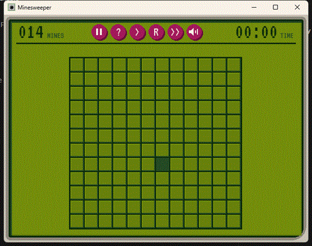

# Minesweeper

A Minesweeper game written from scratch in C++17 with SFML, plus a built-in
solver that can give hints or play the whole game for you.

<p align="center">
  
</p>

## Features

- Boards from 4×4 to 30×30, with Easy / Medium / Hard presets (10 / 15 / 20 %
  mines) or a custom mine percentage from 5 to 50 %
- The first click is always safe: it and its neighbours never hold a mine, so
  every game opens with a clear area
- Chording, flags, a mine counter, a timer and pause
- A solver that never guesses when a safe move can be proven, and picks the
  safest cell by probability when one can't
- Hints: ask for a cell the solver has proven safe
- Resizable window and borderless fullscreen
- Synthesized sound effects (no audio files)

## Download

A Windows installer is attached to each
[GitHub release](https://github.com/yoel2810/minesweeper/releases/latest).

## How to play

Choose a difficulty (or set columns, rows and mine percentage) in the menu and
press **Start Game**.

| Input | Action |
| --- | --- |
| Left click | Reveal a cell |
| Left click on a number | Chord: reveal its unflagged neighbours once the right number of flags is placed around it |
| Right click | Place or remove a flag |
| `?` button | Hint: highlight a cell that is proven safe |
| `>` button | Let the solver play one move |
| `>>` button | Let the solver play on its own; press again or click the board to stop |
| `R` | Restart with the same settings |
| `P` | Pause / resume |
| `M` | Mute / unmute |
| `Esc` | Back to the menu |
| `F11` | Toggle fullscreen |
| `Tab` / `Enter` (menu) | Move between fields / start the game |

## How the solver works

Each move, the solver tries cheap rules first and moves on only when they find
nothing:

1. **Basic rules:** a number whose mines are all flagged clears its other
   neighbours, and a number with exactly as many hidden neighbours as missing
   mines flags them all.
2. **Subset rule:** compares overlapping pairs of numbers.
3. **Exhaustive search:** enumerates every mine layout that fits the border
   of the revealed area, using the total mine count, to find cells that are
   safe or mined in every layout.
4. **Guess:** if nothing is certain, it reveals the cell with the lowest
   probability of holding a mine.

It ignores your flags until it can prove them, so a wrong flag can't mislead
it. The full algorithm is in [docs/solver-pseudocode.md](docs/solver-pseudocode.md).

## Build from source (Windows)

Requires CMake 3.28 or newer and one of these toolchains:

- **MSYS2 UCRT64** with GCC and Ninja (the main toolchain). Put
  `C:\msys64\ucrt64\bin` on `PATH` in the terminal you build from.
- **Visual Studio 2022.**

From the repository root:

```bash
# MSYS2 / Ninja
cmake -S . -B build -G Ninja
cmake --build build
./build/bin/minesweeper.exe
```

```powershell
# Visual Studio
cmake -S . -B build-vs -G "Visual Studio 17 2022"
cmake --build build-vs --config Release
.\build-vs\bin\Release\minesweeper.exe
```

The first configure downloads SFML 3.1.0, so it needs an internet connection
and takes a while. Ninja builds default to `Release`; add
`-DCMAKE_BUILD_TYPE=Debug` for a debug build. The MinGW build links its
runtime statically, so the exe runs without MSYS2 on `PATH`.

### Tests and benchmark

```bash
ctest --test-dir build
./build/bin/solver_bench.exe [columns rows games [seed [minePercent]]]
```

The benchmark plays the solver on random boards and reports wins, guesses and
the slowest turn.

### Installer

`installer/minesweeper.iss` is an [Inno Setup](https://jrsoftware.org/isinfo.php)
script that packages the Release exe (from the Ninja `build/bin`) and the font.

## Roadmap

The game and the classic solver are done. The long-term plan is a
machine-learning agent that learns to play:

- [ ] Design the ML problem and the state representation
- [ ] Generate training data from games
- [ ] Train a first model
- [ ] Evaluate it against the classic solver
- [ ] Visualize the agent playing

## Credits

- Game font: [VT323](https://fonts.google.com/specimen/VT323) by The VT323
  Project Authors, under the SIL Open Font License (`assets/fonts/VT323-OFL.txt`)
- Built with [SFML](https://www.sfml-dev.org/)
